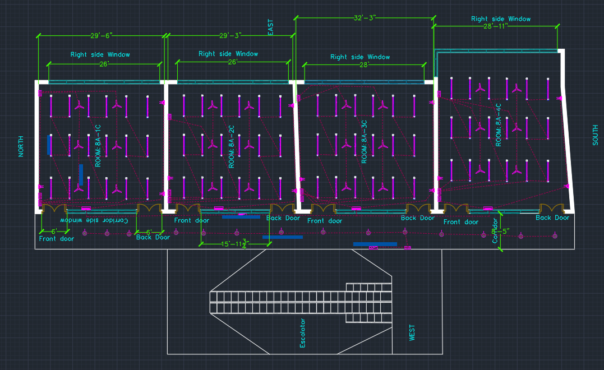
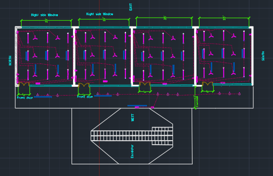
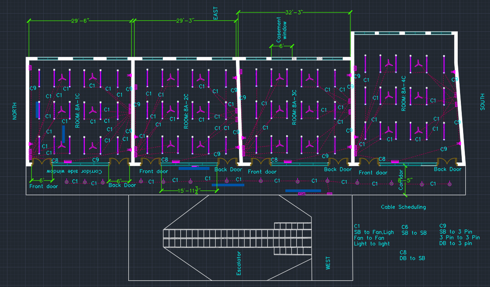

# Electrical Service Design & Energy Optimization of Classrooms

**EEE384 – Electrical Service Design**, BRAC University, Spring 2024 (Group 03)

Electrical service layout of four BRAC University classrooms (**8A-1C to 8A-4C**, Level 8, Block A), drawn in **AutoCAD**. The project covers floor planning, component placement, cable scheduling and load calculation. Two alternative layouts were developed and compared against the existing one, to optimise lighting, fan control, room dimensions, wiring and door placement.

<p align="center"></p>

## Notation

| Symbol | Meaning |
|---|---|
| **TL** | Tube light (18 W LED) |
| **CF** | Ceiling fan (56/48 inch, 75 W) |
| **SB** | Switchboard (the switches inside each room) |
| **DB** | Distribution board (supplies the switchboards) |
| **C1, C6, C8, C9** | Cable types in the cable schedule (see Design approach 2) |
| 26′ / 6″ | Feet / inches |

## How the project was done

1. **Measured the rooms:** the floor is laid with 1 ft × 1 ft tiles, so the tiles were counted to get each room's length and width.
2. **Sketched the layout:** a skeleton plan on paper, marking every light, fan and socket and the switchboard each one connects to.
3. **Drew it in AutoCAD:** walls, doors, windows, dimensions and electrical components.
4. **Designed two alternatives** and **calculated the connected load** of all three layouts.

## The three designs

| | Base design (existing) | Design approach 1 ✅ | Design approach 2 |
|---|---|---|---|
| Tube lights per room | 18 | **9** | 18 |
| Lights per switch | 6 | 3 | as base |
| Fan control | 3 fans per switch | **Individual** | Individual |
| Room shape | Unequal | **Square, equal** | As base |
| Doors per room | 2 | **1** | 2 |
| Cable schedule | – | – | **Drawn (C1–C9)** |
| Drawing | [`base_design.dwg`](cad/base_design.dwg) | [`design_approach_1.dwg`](cad/design_approach_1.dwg) | [`design_approach_2.dwg`](cad/design_approach_2.dwg) |

| Design approach 1 (selected) | Design approach 2 (with cable schedule) |
|---|---|
|  |  |

**Cable schedule (design approach 2):**

| Cable | Connection |
|---|---|
| C1 | SB → fan and light; fan → fan; light → light |
| C6 | SB → SB |
| C8 | DB → SB |
| C9 | SB → 3-pin socket; 3-pin → 3-pin; DB → 3-pin socket |

## Load calculation (all four rooms)

| Load | Quantity | W each | Base design | Design 1 | Design 2 |
|---|---|---|---|---|---|
| Tube lights | 18×4 / **9×4** / 18×4 | 18 | 1,296 W | **648 W** | 1,296 W |
| Ceiling fans | 6×4 | 75 | 1,800 W | 1,800 W | 1,800 W |
| 5 A 3-pin sockets | 3×4 | 1,200 | 14,400 W | 14,400 W | 14,400 W |
| **Total** | | | **17,496 W** | **16,848 W** | **17,496 W** |

**Result:** design approach 1 cuts the **lighting load by 50 % (1,296 W → 648 W)** and the total connected load to 16,848 W.

Its individual fan switches save further energy that the connected-load figure doesn't show: the base design has to run three fans to cool one part of the room.

## Why design approach 1 was chosen

1. **Room dimensions:** square, symmetrical rooms make better use of the space.
2. **Lower load:** half the lights, making more use of daylight from the windows.
3. **Door adjustment:** one door per room lets less cooled air escape, so the HVAC system works more efficiently.
4. **Individual fan control:** every fan has its own switch, so fans run only where needed.

## Repository structure

```
├── cad/       AutoCAD drawings (.dwg): base_design, design_approach_1, design_approach_2
├── figures/   exported views of the three designs
└── report/    full project report (PDF + DOCX)
```

Open the `.dwg` files in AutoCAD, DWG TrueView (free) or any DWG viewer.

## Team

Group 03: Md Istiauk Hossain Rifat, Zohara Kamal, Asif Abdullah Zamee, MD Junayed Karim
